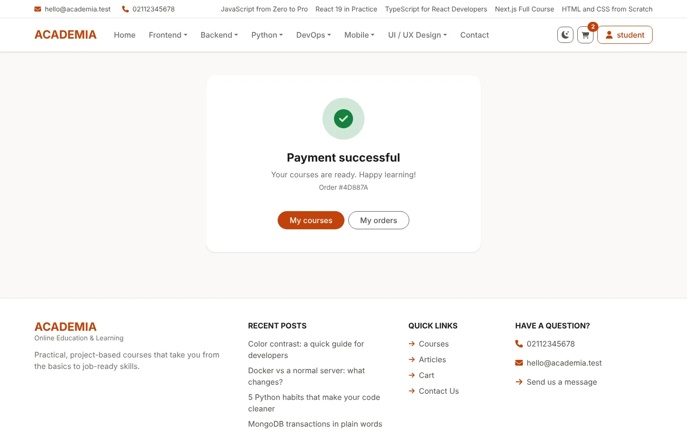
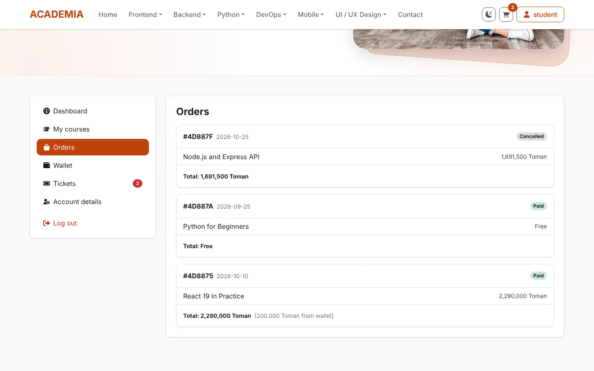
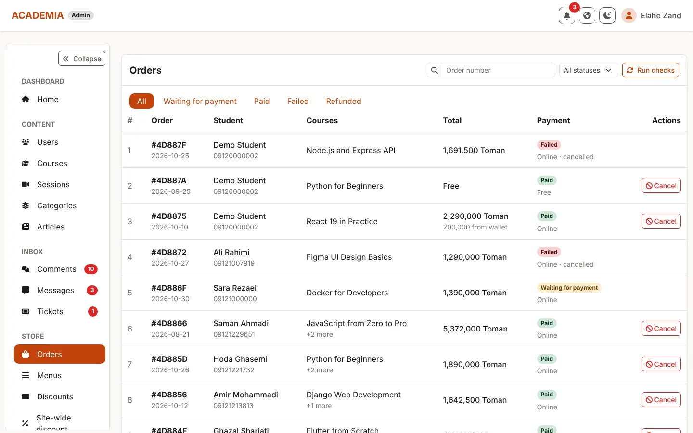
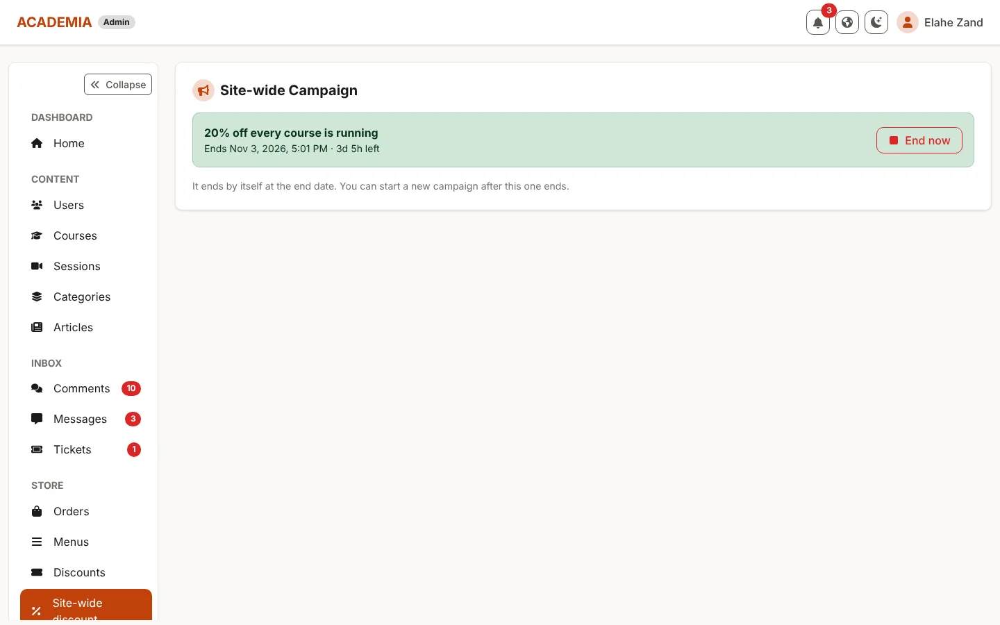

# ACADEMIA — Online Learning Platform

A full-stack online learning platform: course catalog, articles, a server-side cart with discount codes,
online payment with Zarinpal, a wallet, a student account with a ticket chat, and a full admin panel.
React 19 + TypeScript (Vite) on the frontend, Node.js + Express + MongoDB on the backend.


## Features

**For students**
- **Courses** — catalog by category, course page with sessions and comments, free preview sessions
- **Protected videos** — videos are streamed with short-lived signed links, only to enrolled students
- **Cart and checkout** — server-side cart, per-course discount codes, pay online, with the wallet, or both
- **Wallet** — refunds go back to the wallet and can be used on the next purchase
- **Orders** — order history with payment status, cancel unpaid orders
- **Articles** — blog with a reading progress bar and share links
- **Account** — my courses, orders, wallet, profile, notifications and support tickets as a chat

**For admins**
- **Dashboard** with live stats and recent activity
- **Orders** — filter by payment and status, search by order number, cancel and refund an order
- **Content** — create and edit courses, sessions, categories, articles and menus
- **Inbox** — review comments, answer tickets in a chat, reply to contact messages by email
- **Discounts** — per-course codes with a usage limit, and a site-wide discount
- **Users** — roles, ban and unban

**Under the hood**
- **Safe payments** — every money change (checkout, refund, cancel) runs in a MongoDB transaction
- **Idempotent checkout** — a double click or a retry never creates two orders
- **Order sweeper** — runs daily (and from the admin panel) to finish paid orders that got stuck
  and to close unpaid ones after checking with the payment gateway
- **Validation everywhere** — every route validates params, query and body with zod
- **Security** — JWT with refresh tokens, helmet, rate limits on login, comments, tickets and contact forms
- **Light and dark theme**, fully responsive

## Screenshots

| | |
| --- | --- |
|  |  |
|  |  |
|  |  |
|  |  |
|  |  |

**Admin panel**

| | |
| --- | --- |
|  |  |
|  |  |
|  |  |
|  | |

**Mobile**

<p>
  
  
</p>

## Getting started

### 1. MongoDB with a replica set

Payments use MongoDB transactions, and transactions need a replica set.
MongoDB Atlas has one by default. For a local MongoDB, add this to `mongod.cfg` and restart the service:

```yaml
replication:
  replSetName: rs0
```

Then run `rs.initiate()` once in `mongosh`.

### 2. Backend

```bash
cd server
npm install
cp .env.example .env      # set MONGO_URI, secrets and Zarinpal settings
npx tsx src/scripts/seed.js --fresh   # optional: fill the database with sample data
npm run dev               # http://localhost:4000
```

### 3. Frontend (in a second terminal)

```bash
cd client
npm install
cp .env.example .env      # VITE_API_URL=http://localhost:4000/v1
npm run dev               # http://localhost:3000
```

### Demo accounts (after seeding)

| Role    | Email                   | Password      |
| ------- | ----------------------- | ------------- |
| Admin   | `admin@academia.test`   | `Admin1234`   |
| Student | `student@academia.test` | `Student1234` |

Discount codes to try: `WELCOME10` (JavaScript from Zero to Pro), `NODE20` (usage limit already reached).

### Environment (server)

| Variable                | Example                                       |
| ----------------------- | --------------------------------------------- |
| `MONGO_URI`             | `mongodb://127.0.0.1:27017/lms?replicaSet=rs0` |
| `CLIENT_URL`            | `http://localhost:3000`                       |
| `CORS_ORIGIN`           | `http://localhost:3000`                       |
| `ZARINPAL_MERCHANT_ID`  | your merchant id                              |
| `ZARINPAL_SANDBOX`      | `true` for testing, `false` for real payments |
| `ZARINPAL_CALLBACK_URL` | `http://localhost:4000/v1/orders/verify`      |
| `MAIL_USER` / `MAIL_PASS` | Gmail address and app password (optional)  |

With `ZARINPAL_SANDBOX=true` no real money moves: the gateway shows a test page with success and failure buttons.

## Scripts

**Frontend** (inside `client/`)

| Script            | What it does                                  |
| ----------------- | --------------------------------------------- |
| `npm run dev`     | Dev server with hot reload                    |
| `npm run build`   | Type-check (`tsc -b`) and build into `dist/`  |
| `npm run preview` | Serve the production build locally            |
| `npm run lint`    | ESLint (TypeScript + React Hooks rules)       |
| `npm test`        | Vitest (watch mode; `npm test -- --run` once) |

**Backend** (inside `server/`)

| Script                                | What it does                                    |
| ------------------------------------- | ----------------------------------------------- |
| `npm run dev`                         | API with auto restart                           |
| `npm start`                           | API                                             |
| `npx tsx src/scripts/seed.js --fresh` | Delete all data and fill the database with samples |

## Tech stack

**Frontend:** React 19 · TypeScript (strict) · Vite · React Router 7 · TanStack Query 5 · axios ·
react-hook-form + zod · Bootstrap 5.3 (Sass) · react-bootstrap · sonner · Recharts · CKEditor 5 · Vitest + Testing Library

**Backend:** Node.js · Express · MongoDB (Mongoose, transactions) · zod · JWT with refresh tokens · Multer ·
helmet · express-rate-limit · Nodemailer · Zarinpal

## Backend structure

```
server/src/
├── routes/v1/      one router per resource; each route: guard → upload → validate → controller
├── controllers/    public/, user/, admin/ — read req.parsed.data and call a service
├── services/       public/, user/, admin/ — the business logic
│   └── shared/     code used by several roles: cart pricing, order (finalize, cancel, refund),
│                   order sweeper, Zarinpal
├── validators/     zod schemas for params, query and body
├── models/         Mongoose models
├── middlewares/    auth guards, validate, upload, rate limits, error handler
├── jobs/           the daily order sweeper
├── scripts/        seed script and sample cover images
└── utils/          AppError, paginate, transaction, notify, tokens, files
```

### Rules
- A **controller** only reads `req.parsed.data` and returns what the service gives back.
- A **service** throws `AppError.notFound / badRequest / conflict / forbidden`; the error handler turns it into a response.
- **Lists** return `{ items, pagination }` through `utils/paginate`.
- **Money changes** run inside `withTransaction`, so they are saved all together or not at all.

## Frontend structure

```
client/src/
├── app/            App, routes (lazy-loaded pages), AppProviders (React Query + Router + Auth + toasts)
├── api/            client.ts (axios + token refresh), tokenStorage.ts, queryClient.ts
├── types/          models.ts (API data), api.ts (error type), axios.d.ts (custom request flags)
├── validators/     zod schemas for every form, plus the form value types inferred from them
├── features/       one folder per domain: its data hooks + its components
│   ├── auth/       hooks.ts, AuthContext, useAuth, RouteGuards, LoginForm, RegisterForm
│   ├── courses/    hooks.ts, CourseCard, CourseDetail, CourseForm, ...
│   ├── articles/   hooks.ts, ArticleCard, ArticleDetail, ArticleFields, ...
│   ├── tickets/    hooks.ts, TicketChat, ticketView
│   ├── cart/       hook.ts (cart, coupon, checkout), CartSummary
│   ├── orders/     hooks.ts (my orders, admin orders, cancel, checks)
│   └── ...         categories, comments, contacts, discounts, info, menus,
│                   newsletter, notifications, search, users
├── components/
│   ├── layout/     PublicLayout, admin/AdminLayout, account/AccountLayout
│   └── ui/         Navbar, Topbar, Footer, Hero, PageHeader, sidebars, and shared
│                   building blocks: Input, DataTable, Pagination, filters, toasts, ...
├── pages/          route screens only: public/, admin/ (/p-admin), account/ (/my-account)
├── hooks/          useListParams, useReactQueryHooks, useDebouncedValue, useTheme, useInView
├── styles/         main.scss — Bootstrap variables and the few custom rules
└── config/         env.ts
```

### Rules
- A **page** composes features and layout; it holds no fetching logic of its own.
- A **feature** owns its data: `features/<name>/hooks.ts` (`useCourses`, `useCancelOrder`, ...),
  built on the typed `useGet<T>` / `usePost<T, V>` / `usePut` / `useDelete` from `hooks/useReactQueryHooks.ts`.
  Mutations show their own toast and refresh the lists they change.
- **Forms** use `react-hook-form` with `zodResolver(schema)`; the schema lives in `validators/`.
- **Lists** keep their page and filters in the URL (`?page=&status=&q=`) through `useListParams`,
  and read `{ items, pagination }` from the server.

## Styling
- **Bootstrap only.** `src/styles/main.scss` sets Bootstrap's own Sass variables (brand colors,
  neutrals, radius, shadows, dark-mode values) and compiles Bootstrap. Components use Bootstrap classes.
- **Light / dark** use Bootstrap 5.3 color modes (`<html data-bs-theme>`), switched by `useTheme`.
  `index.html` applies the saved theme before the first paint.
- **Icons**: `react-icons/fa6`. **Toasts and confirmations**: `sonner` via `components/ui/toastActions`.
