# ACADEMIA — Online Learning Platform

A full-stack online learning platform: course catalog, articles, cart, student account with a
ticket chat, and an admin panel. React 19 + TypeScript (Vite) on the frontend, Node.js + Express + MongoDB on the backend.


## Features

- **Courses** — catalog by category, course page with sessions and comments, enrollment
- **Cart and checkout** — add courses to a cart that persists in the browser *(payment coming soon)*
- **Articles** — blog with a reading progress bar and share links
- **Student account** — my courses, orders, profile, and support tickets as a chat
- **Admin panel** — dashboard, filters on every list, create and edit courses, articles and sessions,
  answer tickets in a chat, review comments and messages
- **Light and dark theme**, fully responsive

## Screenshots

| | |
| --- | --- |
| 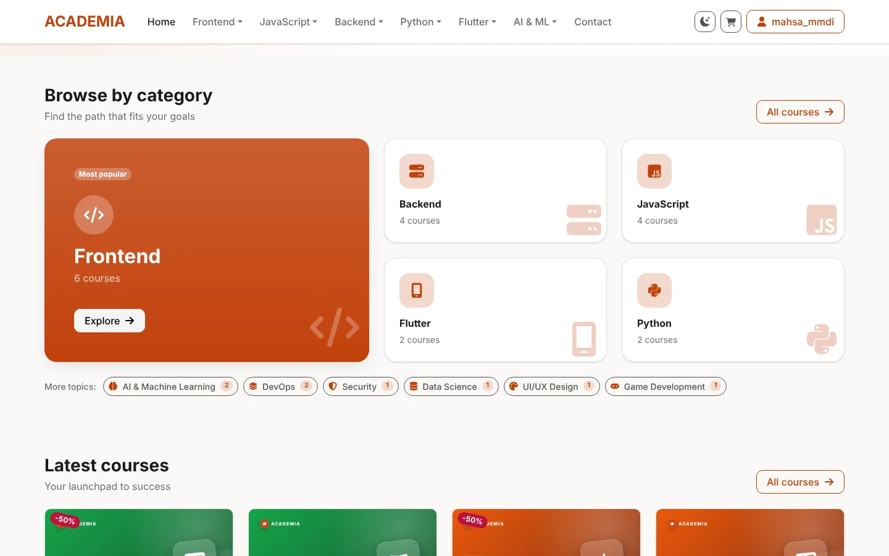 | 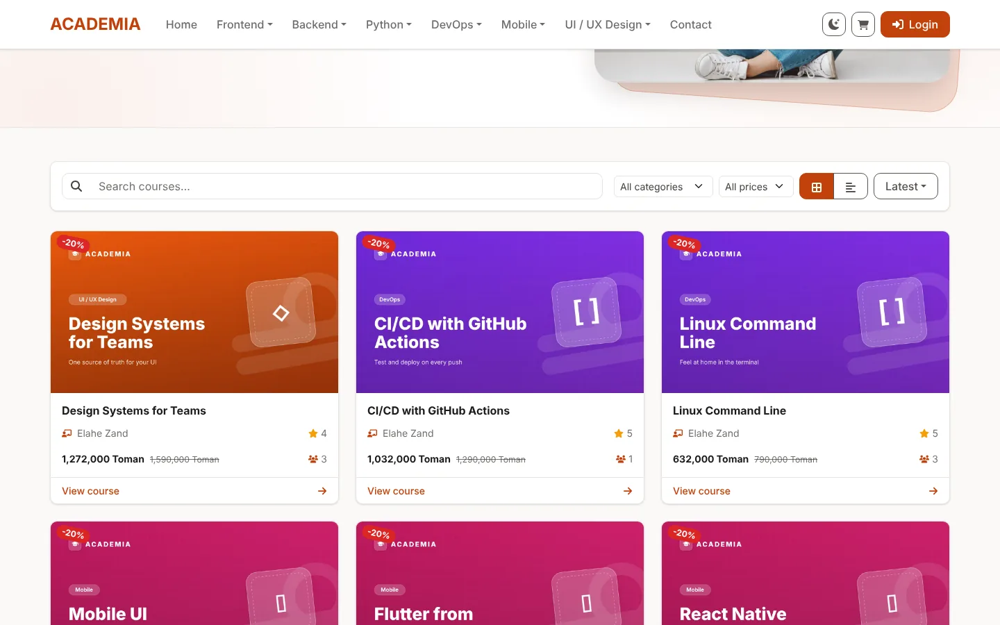 |
| 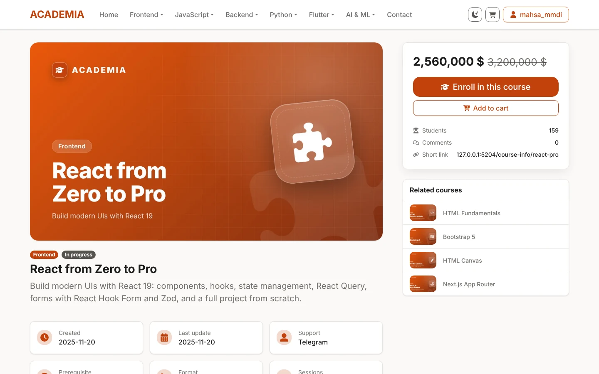 | 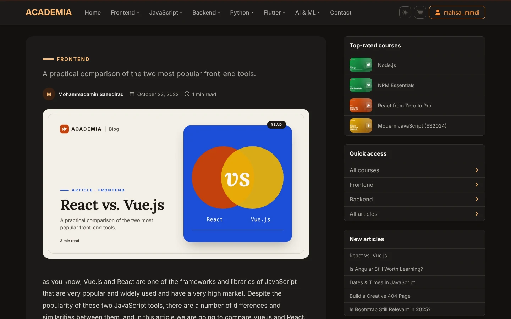 |
| 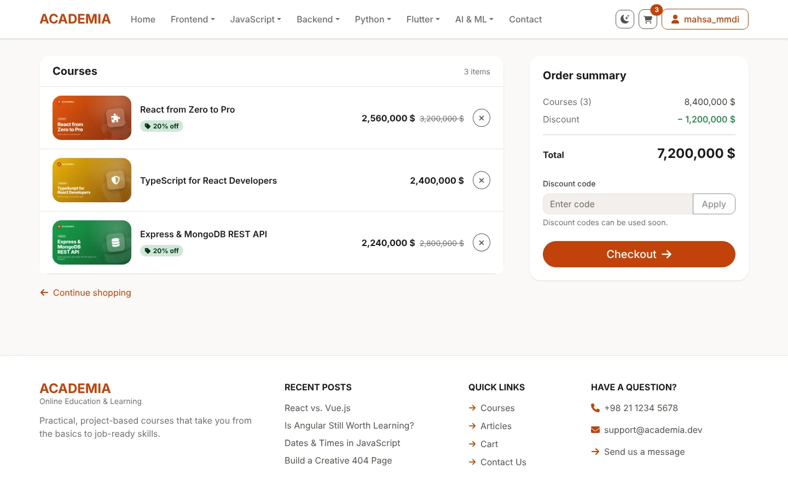 | 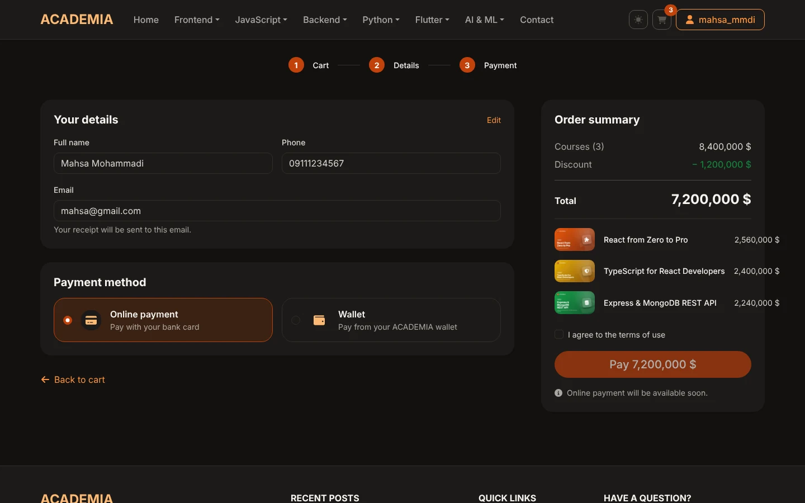 |
| 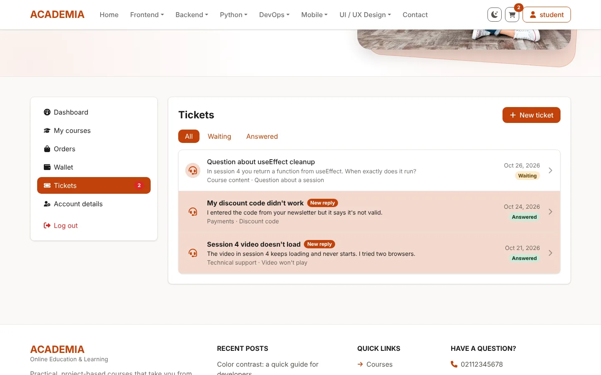 | 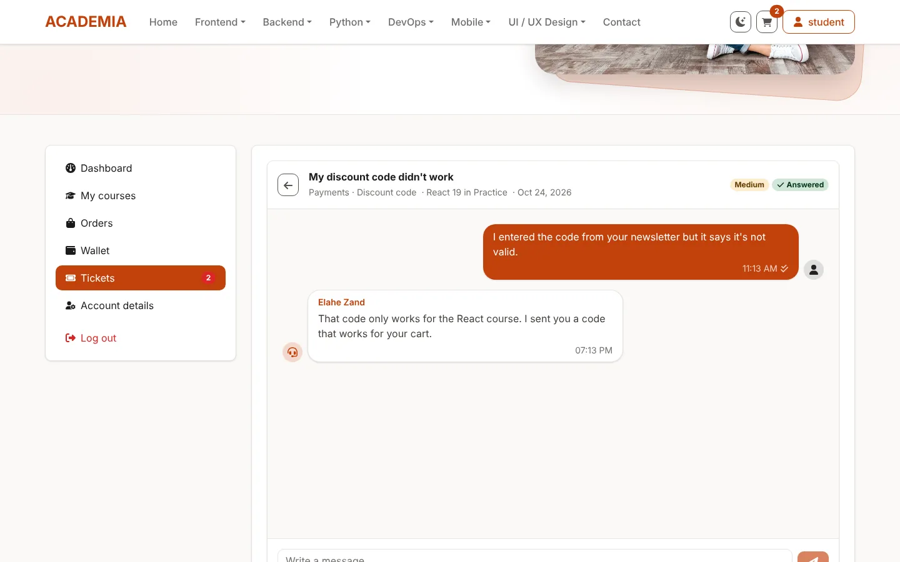 |

**Admin panel**

| | |
| --- | --- |
| 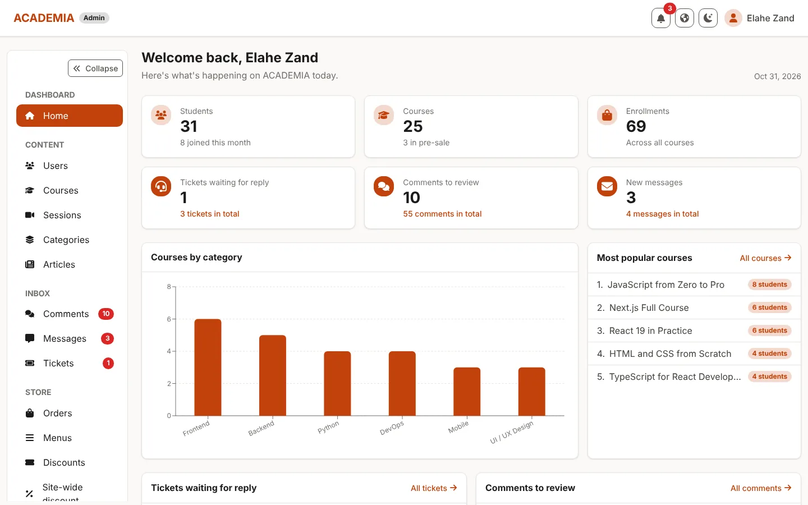 | 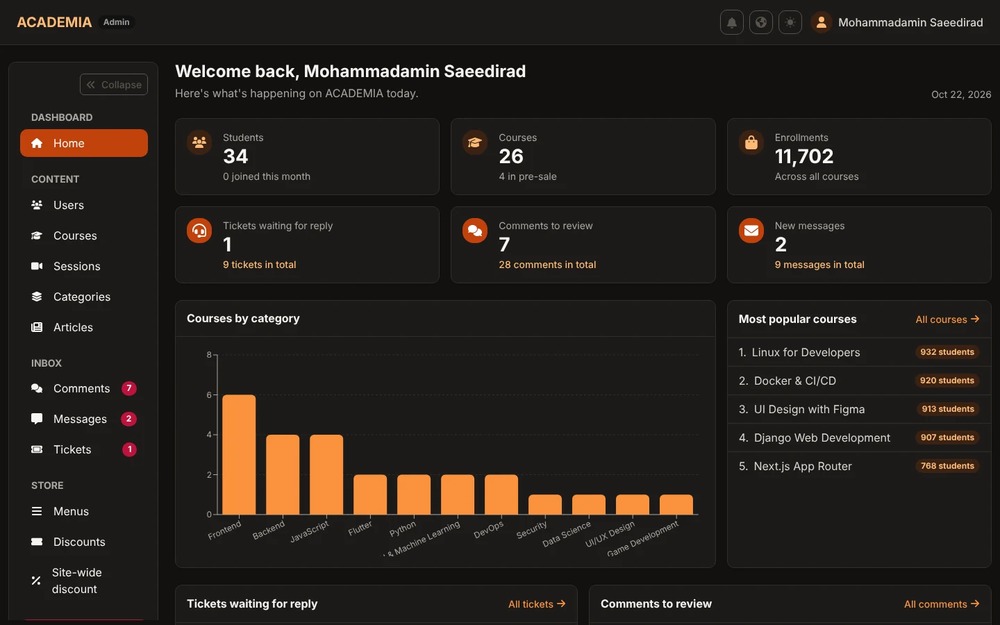 |
| 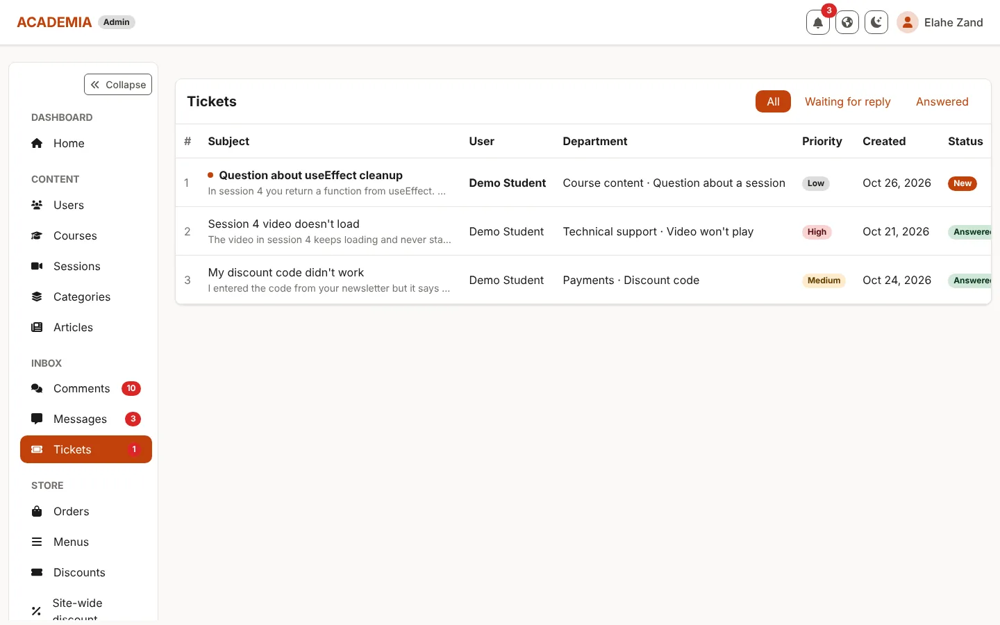 | 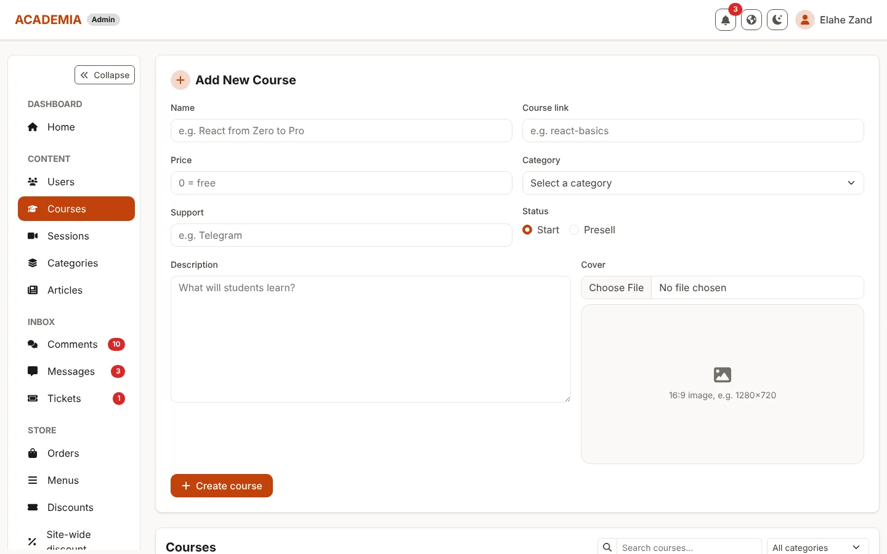 |
| 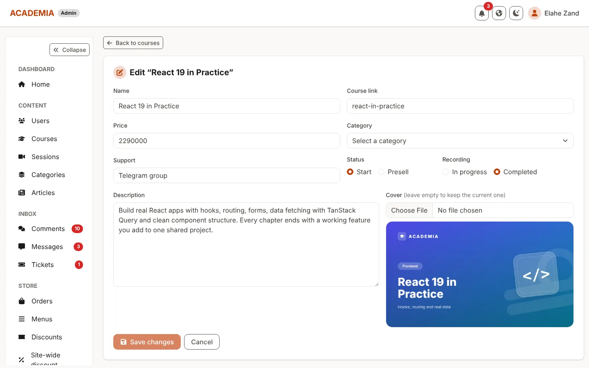 | |

**Mobile**

<p>
  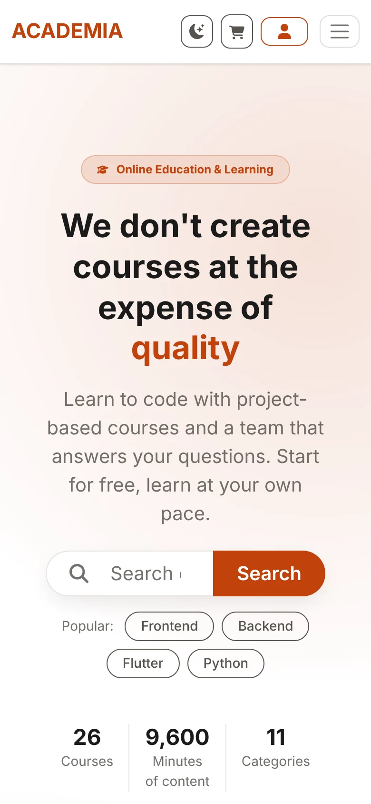
  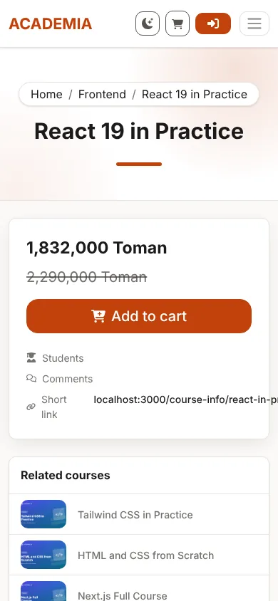
</p>

## Getting started

```bash
# backend
cd server
npm install
npm start                 # http://localhost:4000

# frontend (in a second terminal)
cd client
npm install
cp .env.example .env      # VITE_API_URL=http://localhost:4000/v1
npm run dev               # http://localhost:3000
```

Frontend scripts (run inside `client/`):

| Script              | What it does                                  |
| ------------------- | --------------------------------------------- |
| `npm run dev`       | Dev server with hot reload                    |
| `npm run build`     | Type-check (`tsc -b`) and build into `dist/`  |
| `npm run preview`   | Serve the production build locally            |
| `npm run lint`      | ESLint (TypeScript + React Hooks rules)       |
| `npm test`          | Vitest (watch mode; `npm test -- --run` once) |

## Tech stack

**Frontend:** React 19 · TypeScript (strict) · Vite · React Router 7 · TanStack Query 5 · axios ·
react-hook-form + zod · Bootstrap 5.3 (Sass) · react-bootstrap · sonner · Recharts · CKEditor 5 · Vitest + Testing Library

**Backend:** Node.js · Express · MongoDB (Mongoose) · JWT with refresh tokens · Multer

## Frontend structure

```
client/src/
├── app/            App, routes (lazy-loaded pages), AppProviders (React Query + Router + Auth + toasts)
├── api/            client.ts (axios + token refresh), tokenStorage.ts, queryClient.ts
├── types/          models.ts (API data), api.ts (error type), axios.d.ts (custom request flags)
├── validators/     zod schemas for every form, plus the form value types inferred from them
├── features/       one folder per domain: its data hooks + its components
│   ├── auth/       hooks.ts, AuthContext, useAuth, RouteGuards, LoginForm, RegisterForm
│   ├── courses/    hooks.ts, CourseCard, CourseDetail, CourseForm, ...
│   ├── articles/   hooks.ts, ArticleCard, ArticleDetail, ArticleFields, ...
│   ├── tickets/    hooks.ts, TicketChat, ticketView
│   ├── cart/       useCart, CartSummary
│   └── ...         categories, comments, contacts, discounts, info, menus,
│                   newsletter, notifications, orders, search, users
├── components/
│   ├── layout/     PublicLayout, admin/AdminLayout, account/AccountLayout
│   └── ui/         Navbar, Topbar, Footer, Hero, PageHeader, sidebars, and shared
│                   building blocks: Input, DataTable, Pagination, filters, toasts, ...
├── pages/          route screens only: public/, admin/ (/p-admin), account/ (/my-account)
├── hooks/          useTheme, usePagination, useQueryParam, useStatusFilter, useReactQueryHooks, ...
├── styles/         main.scss — Bootstrap variables and the few custom rules
└── config/         env.ts
```

### Rules
- A **page** composes features and layout; it holds no fetching logic of its own.
- A **feature** owns its data: `features/<name>/hooks.ts` (`useCourses`, `useUpdateCourse`, ...),
  built on the typed `useGet<T>` / `usePost<T, V>` / `usePut` / `useDelete` from `hooks/useReactQueryHooks.ts`.
  Mutations show their own toast and refresh the lists they change.
- **Forms** use `react-hook-form` with `zodResolver(schema)`; the schema lives in `validators/`.
- **Lists** keep their state in the URL: `?page=&limit=` through `usePagination`,
  filters such as `?status=` or `?category=` through `useQueryParam` / `useStatusFilter`.

## Styling
- **Bootstrap only.** `src/styles/main.scss` sets Bootstrap's own Sass variables (brand colors,
  neutrals, radius, shadows, dark-mode values) and compiles Bootstrap. Components use Bootstrap classes.
- **Light / dark** use Bootstrap 5.3 color modes (`<html data-bs-theme>`), switched by `useTheme`.
  `index.html` applies the saved theme before the first paint.
- **Icons**: `react-icons/fa6`. **Toasts and confirmations**: `sonner` via `components/ui/toastActions`.